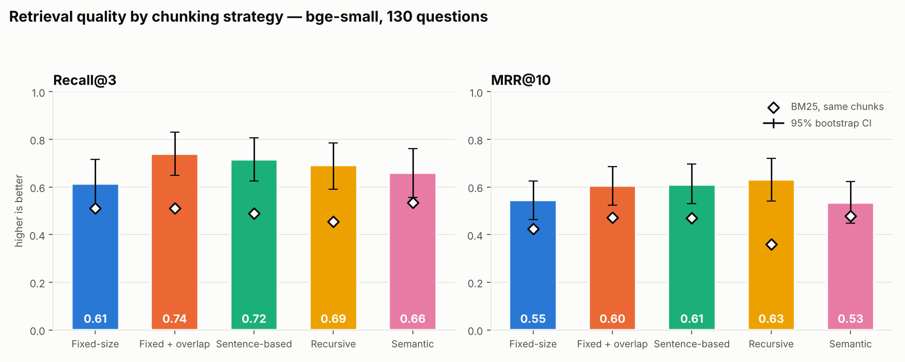
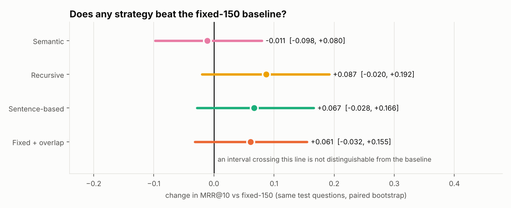
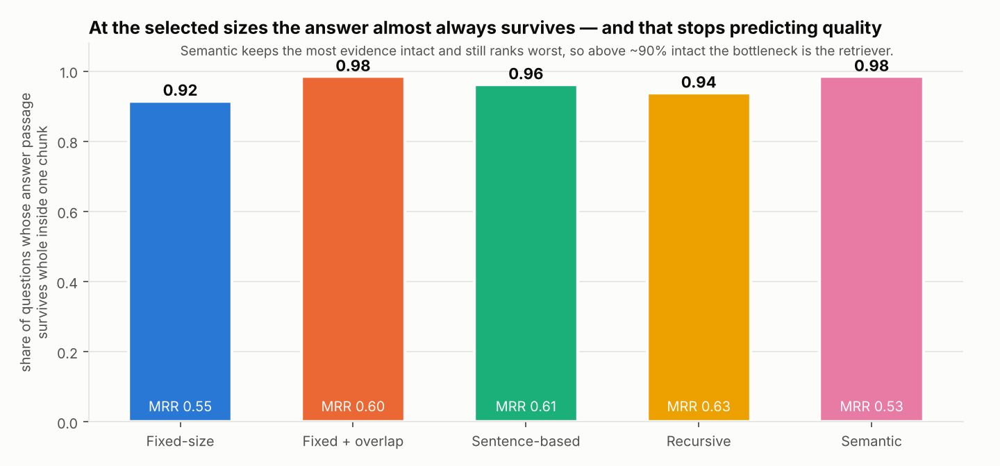
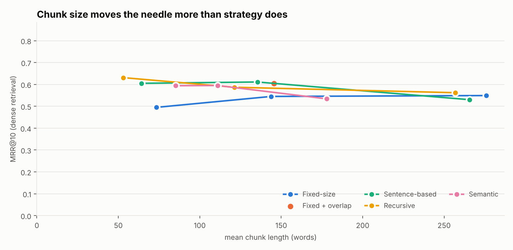

<!-- generated by scripts/make_report.py from results/bge-small — do not edit by hand -->

**Run:** bge-small · 64 documents · 130 questions (102 short evidence, 28 long) · 5,000 bootstrap resamples.

**Protocol:** chunk sizes and thresholds were chosen on 42 dev questions; every number below is measured on the 88 held-out test questions (split seed 0). Selected on dev: `fixed=150`, `fixed_overlap=150`, `recursive=75`, `semantic=95`, `sentence=150`.

### Headline comparison (dense retrieval)

| Strategy | Chunks | Mean words | Evidence intact | Recall@1 | Recall@3 | MRR@10 | Recall @450w budget |
|---|---:|---:|---:|---:|---:|---:|---:|
| Fixed-size | 748 | 144 | 0.92 | 0.40 (0.29–0.50) | 0.61 (0.51–0.72) | 0.55 (0.46–0.63) | 0.61 (0.51–0.72) |
| Fixed + overlap | 915 | 146 | 0.98 | 0.48 (0.38–0.58) | 0.74 (0.65–0.83) | 0.60 (0.52–0.69) | 0.74 (0.65–0.83) |
| Sentence-based | 795 | 135 | 0.96 | 0.48 (0.38–0.58) | 0.72 (0.62–0.81) | 0.61 (0.53–0.70) | 0.72 (0.62–0.81) |
| Recursive | 2030 | 53 | 0.94 | 0.55 (0.44–0.65) | 0.69 (0.59–0.78) | 0.63 (0.54–0.72) | 0.76 (0.67–0.85) |
| Semantic | 605 | 178 | 0.98 | 0.40 (0.29–0.50) | 0.66 (0.56–0.76) | 0.53 (0.45–0.62) | 0.55 (0.44–0.66) |

### Same chunks, BM25 instead of embeddings

| Strategy | Chunks | Mean words | Evidence intact | Recall@1 | Recall@3 | MRR@10 | Recall @450w budget |
|---|---:|---:|---:|---:|---:|---:|---:|
| Fixed-size | 748 | 144 | 0.92 | 0.29 (0.20–0.40) | 0.51 (0.40–0.61) | 0.42 (0.34–0.51) | 0.51 (0.40–0.61) |
| Fixed + overlap | 915 | 146 | 0.98 | 0.39 (0.28–0.49) | 0.51 (0.41–0.61) | 0.47 (0.38–0.56) | 0.51 (0.41–0.61) |
| Sentence-based | 795 | 135 | 0.96 | 0.39 (0.28–0.49) | 0.49 (0.39–0.59) | 0.47 (0.38–0.56) | 0.49 (0.39–0.59) |
| Recursive | 2030 | 53 | 0.94 | 0.25 (0.16–0.34) | 0.46 (0.35–0.56) | 0.36 (0.28–0.45) | 0.56 (0.46–0.66) |
| Semantic | 605 | 178 | 0.98 | 0.36 (0.26–0.47) | 0.53 (0.43–0.64) | 0.48 (0.39–0.56) | 0.40 (0.29–0.50) |

### Is any strategy actually different from plain fixed-size chunking?

| Strategy | Metric | Change vs baseline | 95% CI | Distinguishable? |
|---|---|---:|---|---|
| Fixed + overlap | mrr@10 | +0.061 | [-0.032, +0.155] | no — CI includes 0 |
| Fixed + overlap | recall@3 | +0.125 | [+0.023, +0.239] | **yes** |
| Fixed + overlap | recall@450w | +0.125 | [+0.023, +0.239] | **yes** |
| Sentence-based | mrr@10 | +0.067 | [-0.028, +0.166] | no — CI includes 0 |
| Sentence-based | recall@3 | +0.102 | [-0.011, +0.216] | no — CI includes 0 |
| Sentence-based | recall@450w | +0.102 | [-0.011, +0.216] | no — CI includes 0 |
| Recursive | mrr@10 | +0.087 | [-0.020, +0.192] | no — CI includes 0 |
| Recursive | recall@3 | +0.080 | [-0.045, +0.205] | no — CI includes 0 |
| Recursive | recall@450w | +0.148 | [+0.034, +0.261] | **yes** |
| Semantic | mrr@10 | -0.011 | [-0.098, +0.080] | no — CI includes 0 |
| Semantic | recall@3 | +0.045 | [-0.057, +0.159] | no — CI includes 0 |
| Semantic | recall@450w | -0.068 | [-0.182, +0.057] | no — CI includes 0 |

### Does the answer passage survive chunking?

### Chunk size sweep

| Strategy | Setting | Mean words | Evidence intact | Recall@3 | MRR@10 |
|---|---|---:|---:|---:|---:|
| Fixed-size | 75 words | 73 | 0.80 | 0.59 | 0.49 |
| Fixed-size | 150 words | 144 | 0.92 | 0.61 | 0.55 |
| Fixed-size | 300 words | 276 | 0.96 | 0.70 | 0.55 |
| Fixed + overlap | 150 words + 30 overlap | 146 | 0.98 | 0.74 | 0.60 |
| Sentence-based | 75 words | 64 | 0.93 | 0.67 | 0.60 |
| Sentence-based | 150 words | 135 | 0.96 | 0.72 | 0.61 |
| Sentence-based | 300 words | 266 | 0.98 | 0.61 | 0.53 |
| Recursive | 75 words | 53 | 0.94 | 0.69 | 0.63 |
| Recursive | 150 words | 121 | 0.97 | 0.68 | 0.59 |
| Recursive | 300 words | 257 | 0.99 | 0.66 | 0.56 |
| Semantic | 75th percentile | 85 | 0.98 | 0.67 | 0.59 |
| Semantic | 85th percentile | 111 | 0.98 | 0.68 | 0.59 |
| Semantic | 95th percentile | 178 | 0.98 | 0.66 | 0.53 |

### Short vs long evidence passages

| Strategy | MRR@10 short evidence | MRR@10 long evidence |
|---|---:|---:|
| Fixed-size | 0.53 | 0.58 |
| Fixed + overlap | 0.63 | 0.53 |
| Sentence-based | 0.59 | 0.67 |
| Recursive | 0.63 | 0.62 |
| Semantic | 0.52 | 0.58 |

### Indexing cost

| Strategy | Words embedded to build the index | Relative cost |
|---|---:|---:|
| Fixed-size | 107,617 | 1.00× |
| Fixed + overlap | 133,147 | 1.24× |
| Sentence-based | 107,617 | 1.00× |
| Recursive | 107,617 | 1.00× |
| Semantic | 215,234 | 2.00× |

### Where retrieval failed

| Strategy | Misses (not in top 5) | Evidence split across chunks | Right document, wrong passage | Wrong document |
|---|---:|---:|---:|---:|
| Fixed-size | 20 | 0 | 7 | 13 |
| Fixed + overlap | 20 | 0 | 6 | 14 |
| Sentence-based | 20 | 0 | 7 | 13 |
| Recursive | 23 | 0 | 9 | 14 |
| Semantic | 27 | 0 | 6 | 21 |
