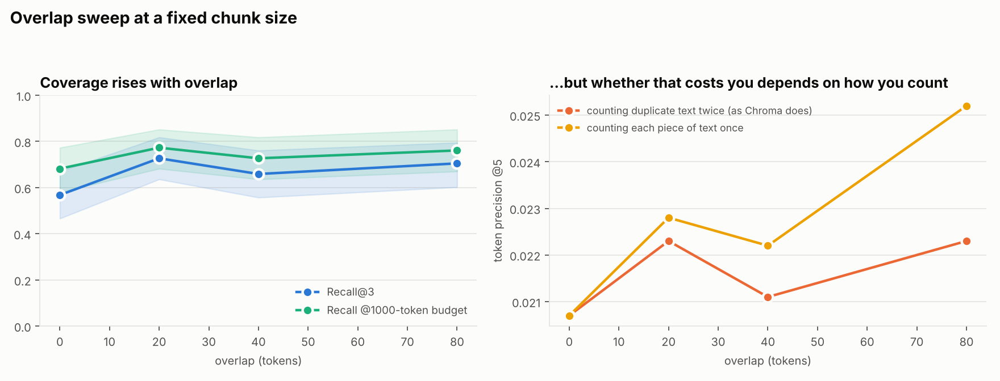
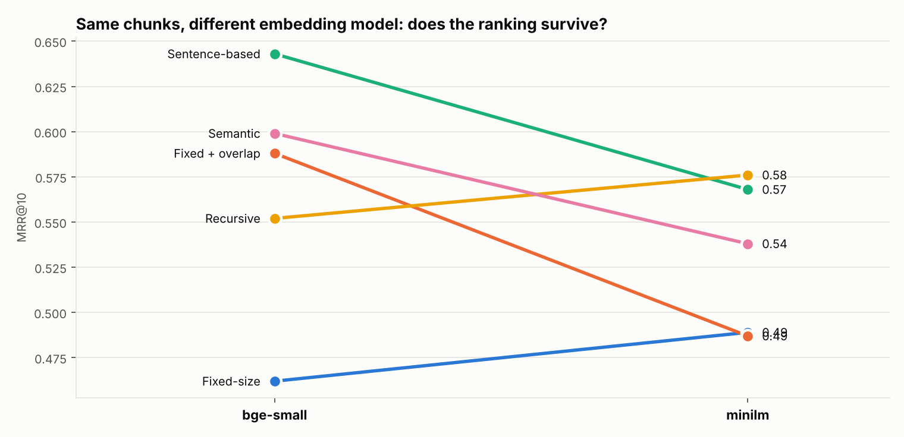

<!-- generated by scripts/make_report.py from results/bge-small; do not edit by hand -->

**Run:** bge-small · 64 documents · 130 questions · 5,000 bootstrap resamples. Sizes are in bge-small WordPiece tokens.

**Protocol:** chunk sizes, overlaps and thresholds were chosen on 42 dev questions; every number below is measured on the 88 held-out test questions (split seed 0). Selected on dev: `fixed 200`, `fixed_overlap 200+80`, `recursive 200`, `semantic 85`, `sentence 100`.

### Headline comparison (dense retrieval)

| Strategy | Setting | Chunks | Mean tokens | Evidence intact | Recall@1 | Recall@3 | MRR@10 | Recall @1000 tok | Token precision@5 |
|---|---|---:|---:|---:|---:|---:|---:|---:|---:|
| Fixed-size | `200` | 904 | 194 | 0.88 | 0.29 (0.20–0.40) | 0.57 (0.47–0.67) | 0.46 (0.38–0.54) | 0.68 (0.58–0.77) | 2.07% |
| Fixed + overlap | `200+80` | 1451 | 197 | 1.00 | 0.46 (0.35–0.56) | 0.70 (0.60–0.80) | 0.59 (0.50–0.67) | 0.76 (0.67–0.85) | 2.23% |
| Sentence-based | `100` | 2051 | 85 | 0.92 | 0.57 (0.47–0.67) | 0.68 (0.59–0.77) | 0.64 (0.56–0.73) | 0.84 (0.76–0.91) | 5.14% |
| Recursive | `200` | 1114 | 157 | 0.95 | 0.40 (0.29–0.50) | 0.65 (0.55–0.75) | 0.55 (0.47–0.63) | 0.80 (0.70–0.88) | 2.65% |
| Semantic | `p85` | 1002 | 175 | 0.99 | 0.46 (0.35–0.56) | 0.69 (0.59–0.80) | 0.60 (0.52–0.68) | 0.75 (0.66–0.84) | 2.28% |

### Same chunks, BM25 instead of embeddings

| Strategy | Setting | Chunks | Mean tokens | Evidence intact | Recall@1 | Recall@3 | MRR@10 | Recall @1000 tok | Token precision@5 |
|---|---|---:|---:|---:|---:|---:|---:|---:|---:|
| Fixed-size | `200` | 904 | 194 | 0.88 | 0.32 (0.23–0.42) | 0.44 (0.34–0.55) | 0.41 (0.32–0.50) | 0.53 (0.43–0.64) | 1.77% |
| Fixed + overlap | `200+80` | 1451 | 197 | 1.00 | 0.35 (0.25–0.46) | 0.46 (0.35–0.56) | 0.44 (0.35–0.53) | 0.59 (0.49–0.69) | 1.94% |
| Sentence-based | `100` | 2051 | 85 | 0.92 | 0.28 (0.19–0.38) | 0.39 (0.28–0.49) | 0.37 (0.28–0.46) | 0.61 (0.51–0.72) | 3.41% |
| Recursive | `200` | 1114 | 157 | 0.95 | 0.28 (0.19–0.38) | 0.49 (0.39–0.59) | 0.39 (0.30–0.48) | 0.58 (0.48–0.68) | 1.81% |
| Semantic | `p85` | 1002 | 175 | 0.99 | 0.34 (0.25–0.44) | 0.55 (0.44–0.65) | 0.46 (0.37–0.55) | 0.55 (0.44–0.65) | 1.71% |

### Dense versus BM25, paired on the same questions

| Strategy | Metric | Dense minus BM25 | 95% CI |
|---|---|---:|---|
| Fixed-size | recall@3 | +0.125 | [+0.000, +0.239] |
| Fixed-size | mrr@10 | +0.052 | [-0.049, +0.151] |
| Sentence-based | recall@3 | +0.295 | [+0.182, +0.409] |
| Sentence-based | mrr@10 | +0.272 | [+0.185, +0.362] |
| Recursive | recall@3 | +0.159 | [+0.034, +0.284] |
| Recursive | mrr@10 | +0.161 | [+0.057, +0.262] |
| Fixed + overlap | recall@3 | +0.250 | [+0.125, +0.375] |
| Fixed + overlap | mrr@10 | +0.150 | [+0.041, +0.261] |
| Semantic | recall@3 | +0.148 | [+0.011, +0.284] |
| Semantic | mrr@10 | +0.143 | [+0.047, +0.241] |

### Is any strategy actually different from the fixed 200 baseline?

| Strategy | Metric | Change vs baseline | 95% CI | Distinguishable? |
|---|---|---:|---|---|
| Fixed + overlap | mrr@10 | +0.126 | [+0.051, +0.204] | **yes** |
| Fixed + overlap | recall@1000tok | +0.080 | [-0.011, +0.171] | no, CI includes 0 |
| Fixed + overlap | recall@3 | +0.136 | [+0.045, +0.227] | **yes** |
| Fixed + overlap | token_iou@5 | +0.0016 | [-0.0009, +0.0042] | no, CI includes 0 |
| Fixed + overlap | token_precision@5 | +0.0016 | [-0.0009, +0.0042] | no, CI includes 0 |
| Fixed + overlap | token_precision_union@5 | +0.0045 | [+0.0019, +0.0073] | **yes** |
| Sentence-based | mrr@10 | +0.181 | [+0.078, +0.285] | **yes** |
| Sentence-based | recall@1000tok | +0.159 | [+0.057, +0.261] | **yes** |
| Sentence-based | recall@3 | +0.114 | [-0.000, +0.239] | no, CI includes 0 |
| Sentence-based | token_iou@5 | +0.0303 | [+0.0235, +0.0375] | **yes** |
| Sentence-based | token_precision@5 | +0.0307 | [+0.0238, +0.0380] | **yes** |
| Sentence-based | token_precision_union@5 | +0.0307 | [+0.0238, +0.0380] | **yes** |
| Recursive | mrr@10 | +0.090 | [+0.007, +0.171] | **yes** |
| Recursive | recall@1000tok | +0.114 | [+0.023, +0.216] | **yes** |
| Recursive | recall@3 | +0.080 | [-0.034, +0.193] | no, CI includes 0 |
| Recursive | token_iou@5 | +0.0057 | [+0.0022, +0.0090] | **yes** |
| Recursive | token_precision@5 | +0.0057 | [+0.0022, +0.0090] | **yes** |
| Recursive | token_precision_union@5 | +0.0057 | [+0.0022, +0.0090] | **yes** |
| Semantic | mrr@10 | +0.138 | [+0.037, +0.242] | **yes** |
| Semantic | recall@1000tok | +0.068 | [-0.045, +0.182] | no, CI includes 0 |
| Semantic | recall@3 | +0.125 | [+0.000, +0.250] | no, CI includes 0 |
| Semantic | token_iou@5 | +0.0021 | [-0.0029, +0.0069] | no, CI includes 0 |
| Semantic | token_precision@5 | +0.0020 | [-0.0030, +0.0068] | no, CI includes 0 |
| Semantic | token_precision_union@5 | +0.0020 | [-0.0030, +0.0068] | no, CI includes 0 |

### The overlap sweep

| Overlap | Chunks | Tokens indexed | Recall@3 | Recall @1000 tok | Token precision@5 (duplicates counted) | Token precision@5 (counted once) |
|---|---:|---:|---:|---:|---:|---:|
| 0 tok (0%) | 904 | 174,963 | 0.57 (0.47–0.67) | 0.68 (0.58–0.77) | 2.07% | 2.07% |
| 20 tok (10%) | 1000 | 193,690 | 0.73 (0.64–0.82) | 0.77 (0.68–0.85) | 2.23% | 2.28% |
| 40 tok (20%) | 1111 | 216,852 | 0.66 (0.56–0.76) | 0.73 (0.64–0.82) | 2.11% | 2.22% |
| 80 tok (40%) | 1451 | 285,914 | 0.70 (0.60–0.80) | 0.76 (0.67–0.85) | 2.23% | 2.52% |

### Every configuration tried

| Configuration | Chunks | Mean tokens | Evidence intact | Recall@3 | MRR@10 | Token precision@5 |
|---|---:|---:|---:|---:|---:|---:|
| `fixed 100` | 1782 | 98 | 0.74 | 0.56 | 0.49 | 3.98% |
| `fixed 200` | 904 | 194 | 0.88 | 0.57 | 0.46 | 2.07% |
| `fixed 400` | 469 | 373 | 0.94 | 0.58 | 0.50 | 1.12% |
| `fixed_overlap 200+20` | 1000 | 194 | 0.94 | 0.73 | 0.59 | 2.23% |
| `fixed_overlap 200+40` | 1111 | 195 | 0.94 | 0.66 | 0.58 | 2.11% |
| `fixed_overlap 200+80` | 1451 | 197 | 1.00 | 0.70 | 0.59 | 2.23% |
| `sentence 100` | 2051 | 85 | 0.92 | 0.68 | 0.64 | 5.14% |
| `sentence 200` | 963 | 182 | 0.93 | 0.66 | 0.57 | 2.34% |
| `sentence 400` | 483 | 362 | 0.97 | 0.60 | 0.52 | 1.23% |
| `recursive 100` | 2513 | 70 | 0.94 | 0.67 | 0.63 | 5.73% |
| `recursive 200` | 1114 | 157 | 0.95 | 0.65 | 0.55 | 2.65% |
| `recursive 400` | 519 | 337 | 1.00 | 0.62 | 0.58 | 1.33% |
| `semantic p75` | 1310 | 134 | 0.99 | 0.73 | 0.59 | 2.82% |
| `semantic p85` | 1002 | 175 | 0.99 | 0.69 | 0.60 | 2.28% |
| `semantic p95` | 604 | 290 | 1.00 | 0.67 | 0.53 | 1.51% |

### Indexing cost

| Strategy | Tokens embedded to build the index | Relative cost |
|---|---:|---:|
| Fixed-size | 174,963 | 1.00× |
| Fixed + overlap | 285,914 | 1.63× |
| Sentence-based | 174,979 | 1.00× |
| Recursive | 174,979 | 1.00× |
| Semantic | 349,958 | 2.00× |

### Where retrieval failed

| Configuration | Misses (not in top 5) | Evidence split across chunks | Right document, wrong passage | Wrong document |
|---|---:|---:|---:|---:|
| `fixed 200` | 27 | 0 | 8 | 19 |
| `fixed_overlap 200+80` | 21 | 0 | 5 | 16 |
| `sentence 100` | 22 | 0 | 12 | 10 |
| `recursive 200` | 23 | 0 | 10 | 13 |
| `semantic p85` | 19 | 0 | 7 | 12 |

### Same chunks, a different embedding model

| Strategy | Configuration | MRR@10 (bge-small) | rank | MRR@10 (minilm) | rank |
|---|---|---:|---:|---:|---:|
| Fixed-size | `fixed 200` | 0.46 | 5 | 0.49 | 4 |
| Fixed + overlap | `fixed_overlap 200+80` | 0.59 | 3 | 0.49 | 5 |
| Sentence-based | `sentence 100` | 0.64 | 1 | 0.57 | 2 |
| Recursive | `recursive 200` | 0.55 | 4 | 0.58 | 1 |
| Semantic | `semantic p85` | 0.60 | 2 | 0.54 | 3 |
