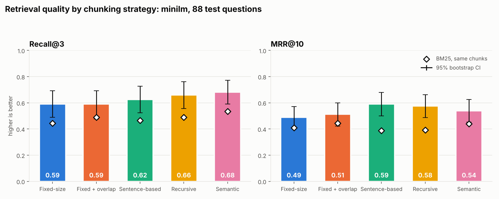
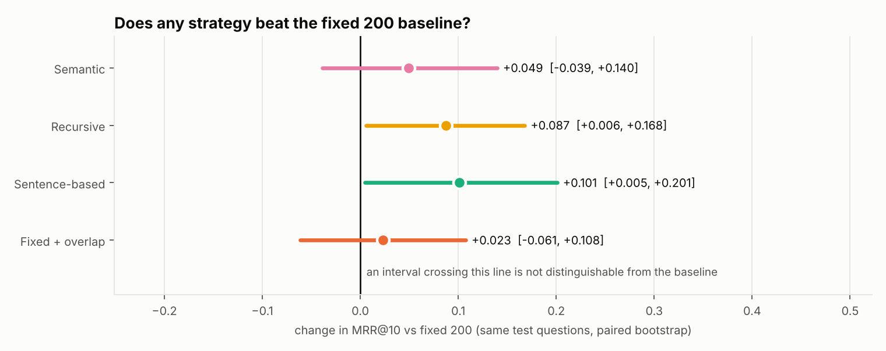
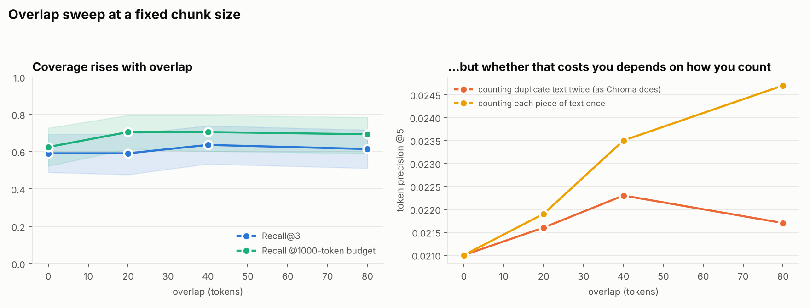
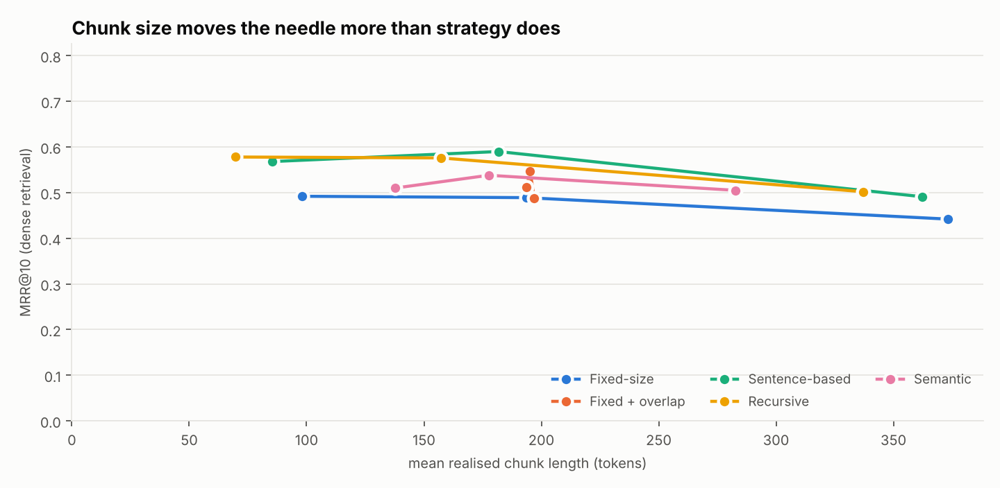

<!-- generated by scripts/make_report.py from results/minilm; do not edit by hand -->

**Run:** minilm · 64 documents · 130 questions · 5,000 bootstrap resamples. Sizes are in bge-small WordPiece tokens.

**Protocol:** chunk sizes, overlaps and thresholds were chosen on 42 dev questions; every number below is measured on the 88 held-out test questions (split seed 0). Selected on dev: `fixed 200`, `fixed_overlap 200+20`, `recursive 200`, `semantic 85`, `sentence 200`.

### Headline comparison (dense retrieval)

| Strategy | Setting | Chunks | Mean tokens | Evidence intact | Recall@1 | Recall@3 | MRR@10 | Recall @1000 tok | Token precision@5 |
|---|---|---:|---:|---:|---:|---:|---:|---:|---:|
| Fixed-size | `200` | 904 | 194 | 0.88 | 0.35 (0.25–0.46) | 0.59 (0.49–0.69) | 0.49 (0.40–0.57) | 0.62 (0.52–0.73) | 2.10% |
| Fixed + overlap | `200+20` | 1000 | 194 | 0.94 | 0.40 (0.29–0.50) | 0.59 (0.48–0.69) | 0.51 (0.42–0.60) | 0.70 (0.61–0.80) | 2.16% |
| Sentence-based | `200` | 963 | 182 | 0.93 | 0.50 (0.40–0.60) | 0.62 (0.52–0.73) | 0.59 (0.50–0.68) | 0.75 (0.66–0.84) | 2.14% |
| Recursive | `200` | 1114 | 157 | 0.95 | 0.46 (0.35–0.56) | 0.66 (0.56–0.76) | 0.58 (0.49–0.66) | 0.76 (0.67–0.84) | 2.64% |
| Semantic | `p85` | 985 | 178 | 1.00 | 0.40 (0.29–0.50) | 0.68 (0.59–0.77) | 0.54 (0.45–0.63) | 0.69 (0.60–0.78) | 2.22% |

### Same chunks, BM25 instead of embeddings

| Strategy | Setting | Chunks | Mean tokens | Evidence intact | Recall@1 | Recall@3 | MRR@10 | Recall @1000 tok | Token precision@5 |
|---|---|---:|---:|---:|---:|---:|---:|---:|---:|
| Fixed-size | `200` | 904 | 194 | 0.88 | 0.32 (0.23–0.42) | 0.44 (0.34–0.55) | 0.41 (0.32–0.50) | 0.53 (0.43–0.64) | 1.77% |
| Fixed + overlap | `200+20` | 1000 | 194 | 0.94 | 0.35 (0.25–0.46) | 0.49 (0.39–0.59) | 0.44 (0.35–0.54) | 0.60 (0.50–0.70) | 1.82% |
| Sentence-based | `200` | 963 | 182 | 0.93 | 0.26 (0.17–0.35) | 0.47 (0.36–0.57) | 0.39 (0.31–0.47) | 0.58 (0.48–0.68) | 1.79% |
| Recursive | `200` | 1114 | 157 | 0.95 | 0.28 (0.19–0.38) | 0.49 (0.39–0.59) | 0.39 (0.30–0.48) | 0.58 (0.48–0.68) | 1.81% |
| Semantic | `p85` | 985 | 178 | 1.00 | 0.32 (0.23–0.42) | 0.53 (0.43–0.65) | 0.44 (0.35–0.53) | 0.53 (0.43–0.64) | 1.66% |

### Dense versus BM25, paired on the same questions

| Strategy | Metric | Dense minus BM25 | 95% CI |
|---|---|---:|---|
| Fixed-size | recall@3 | +0.148 | [+0.011, +0.273] |
| Fixed-size | mrr@10 | +0.079 | [-0.028, +0.182] |
| Sentence-based | recall@3 | +0.159 | [+0.023, +0.295] |
| Sentence-based | mrr@10 | +0.202 | [+0.094, +0.309] |
| Recursive | recall@3 | +0.171 | [+0.034, +0.295] |
| Recursive | mrr@10 | +0.185 | [+0.074, +0.291] |
| Fixed + overlap | recall@3 | +0.102 | [-0.034, +0.239] |
| Fixed + overlap | mrr@10 | +0.068 | [-0.046, +0.184] |
| Semantic | recall@3 | +0.148 | [+0.023, +0.273] |
| Semantic | mrr@10 | +0.099 | [-0.009, +0.208] |

### Is any strategy actually different from the fixed 200 baseline?

| Strategy | Metric | Change vs baseline | 95% CI | Distinguishable? |
|---|---|---:|---|---|
| Fixed + overlap | mrr@10 | +0.023 | [-0.061, +0.108] | no, CI includes 0 |
| Fixed + overlap | recall@1000tok | +0.080 | [-0.023, +0.182] | no, CI includes 0 |
| Fixed + overlap | recall@3 | +0.000 | [-0.102, +0.102] | no, CI includes 0 |
| Fixed + overlap | token_iou@5 | +0.0005 | [-0.0026, +0.0038] | no, CI includes 0 |
| Fixed + overlap | token_precision@5 | +0.0005 | [-0.0026, +0.0038] | no, CI includes 0 |
| Fixed + overlap | token_precision_union@5 | +0.0009 | [-0.0023, +0.0042] | no, CI includes 0 |
| Sentence-based | mrr@10 | +0.101 | [+0.005, +0.201] | **yes** |
| Sentence-based | recall@1000tok | +0.125 | [+0.011, +0.239] | **yes** |
| Sentence-based | recall@3 | +0.034 | [-0.068, +0.148] | no, CI includes 0 |
| Sentence-based | token_iou@5 | +0.0003 | [-0.0040, +0.0042] | no, CI includes 0 |
| Sentence-based | token_precision@5 | +0.0003 | [-0.0039, +0.0042] | no, CI includes 0 |
| Sentence-based | token_precision_union@5 | +0.0003 | [-0.0039, +0.0042] | no, CI includes 0 |
| Recursive | mrr@10 | +0.087 | [+0.006, +0.168] | **yes** |
| Recursive | recall@1000tok | +0.136 | [+0.045, +0.227] | **yes** |
| Recursive | recall@3 | +0.068 | [-0.023, +0.159] | no, CI includes 0 |
| Recursive | token_iou@5 | +0.0053 | [+0.0014, +0.0090] | **yes** |
| Recursive | token_precision@5 | +0.0054 | [+0.0015, +0.0090] | **yes** |
| Recursive | token_precision_union@5 | +0.0054 | [+0.0015, +0.0090] | **yes** |
| Semantic | mrr@10 | +0.049 | [-0.039, +0.140] | no, CI includes 0 |
| Semantic | recall@1000tok | +0.068 | [-0.034, +0.182] | no, CI includes 0 |
| Semantic | recall@3 | +0.091 | [-0.011, +0.204] | no, CI includes 0 |
| Semantic | token_iou@5 | +0.0012 | [-0.0022, +0.0049] | no, CI includes 0 |
| Semantic | token_precision@5 | +0.0011 | [-0.0023, +0.0048] | no, CI includes 0 |
| Semantic | token_precision_union@5 | +0.0011 | [-0.0023, +0.0048] | no, CI includes 0 |

### The overlap sweep

| Overlap | Chunks | Tokens indexed | Recall@3 | Recall @1000 tok | Token precision@5 (duplicates counted) | Token precision@5 (counted once) |
|---|---:|---:|---:|---:|---:|---:|
| 0 tok (0%) | 904 | 174,963 | 0.59 (0.49–0.69) | 0.62 (0.52–0.73) | 2.10% | 2.10% |
| 20 tok (10%) | 1000 | 193,690 | 0.59 (0.48–0.69) | 0.70 (0.61–0.80) | 2.16% | 2.19% |
| 40 tok (20%) | 1111 | 216,852 | 0.64 (0.53–0.74) | 0.70 (0.60–0.80) | 2.23% | 2.35% |
| 80 tok (40%) | 1451 | 285,914 | 0.61 (0.51–0.72) | 0.69 (0.59–0.78) | 2.17% | 2.47% |

### Every configuration tried

| Configuration | Chunks | Mean tokens | Evidence intact | Recall@3 | MRR@10 | Token precision@5 |
|---|---:|---:|---:|---:|---:|---:|
| `fixed 100` | 1782 | 98 | 0.74 | 0.57 | 0.49 | 4.07% |
| `fixed 200` | 904 | 194 | 0.88 | 0.59 | 0.49 | 2.10% |
| `fixed 400` | 469 | 373 | 0.94 | 0.52 | 0.44 | 0.97% |
| `fixed_overlap 200+20` | 1000 | 194 | 0.94 | 0.59 | 0.51 | 2.16% |
| `fixed_overlap 200+40` | 1111 | 195 | 0.94 | 0.64 | 0.55 | 2.23% |
| `fixed_overlap 200+80` | 1451 | 197 | 1.00 | 0.61 | 0.49 | 2.17% |
| `sentence 100` | 2051 | 85 | 0.92 | 0.64 | 0.57 | 5.34% |
| `sentence 200` | 963 | 182 | 0.93 | 0.62 | 0.59 | 2.14% |
| `sentence 400` | 483 | 362 | 0.97 | 0.58 | 0.49 | 1.15% |
| `recursive 100` | 2513 | 70 | 0.94 | 0.68 | 0.58 | 6.29% |
| `recursive 200` | 1114 | 157 | 0.95 | 0.66 | 0.58 | 2.64% |
| `recursive 400` | 519 | 337 | 1.00 | 0.60 | 0.50 | 1.13% |
| `semantic p75` | 1271 | 138 | 1.00 | 0.61 | 0.51 | 2.68% |
| `semantic p85` | 985 | 178 | 1.00 | 0.68 | 0.54 | 2.22% |
| `semantic p95` | 619 | 283 | 0.98 | 0.57 | 0.51 | 1.31% |

### Indexing cost

| Strategy | Tokens embedded to build the index | Relative cost |
|---|---:|---:|
| Fixed-size | 174,963 | 1.00× |
| Fixed + overlap | 193,690 | 1.11× |
| Sentence-based | 174,979 | 1.00× |
| Recursive | 174,979 | 1.00× |
| Semantic | 349,958 | 2.00× |

### Where retrieval failed

| Configuration | Misses (not in top 5) | Evidence split across chunks | Right document, wrong passage | Wrong document |
|---|---:|---:|---:|---:|
| `fixed 200` | 32 | 0 | 14 | 18 |
| `fixed_overlap 200+20` | 27 | 0 | 10 | 17 |
| `sentence 200` | 24 | 0 | 10 | 14 |
| `recursive 200` | 22 | 0 | 13 | 9 |
| `semantic p85` | 24 | 0 | 4 | 20 |
